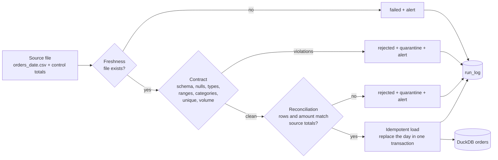

# Chaos-proof pipelines

Pipelines that survive bad data, late data and reruns. A generator breaks the source file on purpose, and the pipeline has to catch every break before anything bad is loaded. Everything uses synthetic orders data, so nothing is downloaded and no employer data is involved.

**Result:** 9 of 9 injected faults are caught by the rule expected to catch them, and rerunning any day leaves zero duplicates (checked by the test suite and in CI).

## The faults

| Fault injected | What breaks | Caught by |
| --- | --- | --- |
| duplicate_rows | Same order twice | contract: unique |
| null_key | Empty order id | contract: nullable |
| schema_rename | Column renamed (`amount` to `amt`) | contract: schema |
| type_change | Text in a number column | contract: type |
| out_of_range | Negative amounts | contract: range |
| bad_category | Unknown currency code | contract: allowed |
| volume_drop | Only 10% of the usual rows | contract: volume |
| silent_truncate | A few rows lost, file still looks normal | reconciliation against source totals |
| missing_file | The file never arrived | freshness |

`silent_truncate` is the important one: no rule on the data alone can see it. Only comparing against the totals the source reports catches it.

## Design decisions

- **Contract first, then reconciliation.** The contract says what good data looks like. Reconciliation proves nothing was lost on the way.
- **Bad files are quarantined, not loaded.** A rejected day leaves the warehouse untouched, and the file is kept for inspection.
- **Idempotent loads.** A day is deleted and re-inserted inside one transaction, so rerunning or backfilling any range gives identical results.
- **Every run is logged** with status, which rule caught it and how many milliseconds detection took.
- **Alerts** print always, and post to Telegram when `TELEGRAM_BOT_TOKEN` and `TELEGRAM_CHAT_ID` are set.
- **Orchestration** is Dagster with one partition per day, a daily schedule and backfill from the UI.

## Talk track

"I assume sources will break. Contracts say what good looks like, reconciliation proves nothing was lost, and idempotent loads make reruns safe. I wrote a fault injector with nine faults and a test that fails if any slips through."

See `HOW_TO_RUN.md` for the exact steps.
